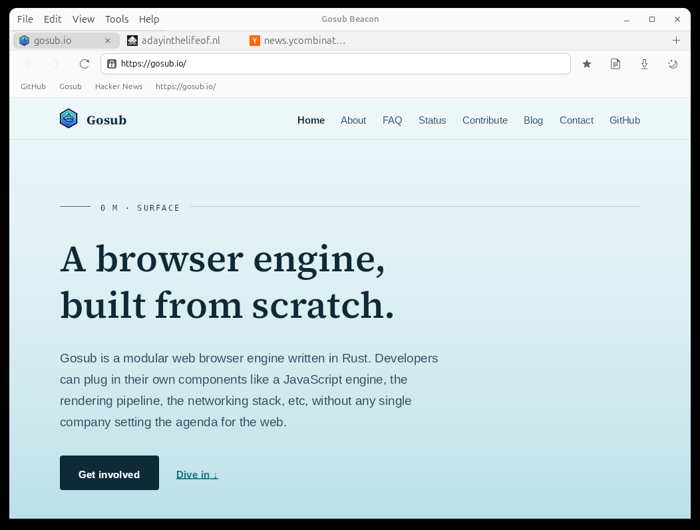

# Gosub Beacon

Beacon is a browser built on the [Gosub engine](https://github.com/gosub-io/gosub-engine).
The engine does the actual work (networking, cookies, storage, history, rendering); Beacon
is the native chrome around it: a GTK4 shell on Linux, a Swift/AppKit shell on macOS, a
C#/WPF shell on Windows and an egui app on Android, all over the same Rust core. It
exists to test the engine in a real application, so don't expect a daily driver, but basic
browsing works.



More in [docs/screenshots](./docs/screenshots/).

## Platforms

- **Linux**: the GTK shell, the most complete one. It is also packaged as a Flatpak,
  which brings its own GTK and so runs on distributions whose GTK is too old; see
  [packaging/flatpak](./packaging/flatpak/README.md). A second, minimal frontend in egui
  (Vello on wgpu, no GTK or Skia) does tabs, navigation and rendering and little else;
  it is also the Android app.
- **macOS**: a native Swift/AppKit shell in [swift/](./swift/README.md), over the C ABI in
  `crates/beacon-ffi`. Signed and notarized DMGs are published at
  [gosub.io/build](https://gosub.io/build).
- **Windows**: a C#/WPF shell in [windows/](./windows/README.md), over the same C ABI.
  It renders on the CPU (Skia), not the GPU. Both halves cross-compile from Linux with
  `windows/build.sh`; running it needs Windows. Not built in CI.
- **Android**: the egui frontend as a NativeActivity (`crates/beacon-android`), built into
  a debug-signed arm64 APK by `scripts/android-apk.sh`. Android 8.0 (API 26) and newer.
  On top of the desktop egui it has downloads (copied into the shared Downloads folder on
  Android 10 and newer; older versions keep them in the app's own storage) and the system
  date and time pickers for form inputs. The engine runs in-process, without component
  isolation. Not built in CI.

## Getting the source

Beacon uses path dependencies into the engine, so check out
[gosub-engine](https://github.com/gosub-io/gosub-engine) next to this repository
(`../gosub-engine`), on the `beacon` branch (upstream main plus engine work Beacon
needs that has not merged yet):

```bash
git clone https://github.com/gosub-io/gosub-beacon.git
git clone -b beacon https://github.com/gosub-io/gosub-engine.git
cd gosub-beacon
```

You need Rust from [rustup](https://rustup.rs); `rust-toolchain.toml` selects stable. The
first build compiles the engine and takes a few minutes.

## Building and running on Linux

Dependencies on Debian/Ubuntu, or similar on other systems:

```bash
sudo apt install libgtk-4-dev libglib2.0-dev libcairo2-dev libgdk-pixbuf-2.0-dev \
                 libpango1.0-dev libsqlite3-dev libssl-dev pkg-config \
                 clang libclang-dev libgl-dev libegl-dev libfontconfig-dev libfreetype-dev
```

These are for the GTK frontend. The egui one needs none of them:

```bash
cargo build                                          # both binaries
cargo build --no-default-features --features egui   # just the egui one
```

```bash
cargo run --bin gosub-beacon-gtk                          # opens the default startup tabs
cargo run --bin gosub-beacon-gtk -- https://example.com   # URLs become the startup tabs
cargo run --bin gosub-beacon-egui -- https://example.com  # the other frontend
```

## Profiles

Everything Beacon keeps about you (settings, cookies, bookmarks, history, site storage, open
tabs) lives in one profile folder, which can be copied to another machine (see Encryption
below). Its cache lives outside it and is rebuilt when missing.

| | Linux | macOS |
| --- | --- | --- |
| Profiles | `~/.local/share/gosub-beacon/profiles/<id>/` | `~/Library/Application Support/gosub-beacon/profiles/<id>/` |
| Cache | `~/.cache/gosub-beacon/<id>/` | `~/Library/Caches/gosub-beacon/<id>/` |

A Beacon from before profiles kept these files straight in `gosub-beacon/`; the first start
moves them into a profile named `default`.

```bash
cargo run --bin gosub-beacon-gtk -- --profile work          # open (or create) the profile "work"
cargo run --bin gosub-beacon-gtk -- --user-data-dir /tmp/p  # use exactly this folder
cargo run -p beaconctl -- profile list                      # list, show, create, set-default, path
```

One Beacon process opens a profile at a time; a second one on the same profile is refused.

### Encryption

A profile's databases are always encrypted, with a key kept in the system keychain (Secret
Service on Linux, Keychain on macOS, Credential Manager on Windows); the first start
encrypts the ones already on disk. Without a keychain Beacon does not start, Android aside
(see below): on Linux that means a running Secret Service such as GNOME Keyring or KWallet.

That key never leaves the machine, so an encrypted profile copied elsewhere opens there
only once it has a passphrase:

```bash
cargo run -p beaconctl -- profile passphrase              # set or change it (the default profile)
cargo run -p beaconctl -- profile unlock work             # on the new machine: passphrase -> keychain
cargo run -p beaconctl -- profile forget work             # drop this machine's key (asks for the passphrase)
cargo run -p beaconctl -- profile remove-passphrase work  # back to this machine only
```

On a Mac, `beaconctl` is inside the app: `Gosub Beacon.app/Contents/MacOS/beaconctl`. Use
that one; the keychain item holding the key trusts it and the app for each other, where a
`beaconctl` built elsewhere is asked about once per build.

Changing or removing the passphrase re-encrypts the databases under a new key, so an older
copy of `profile.toml` no longer opens them with the passphrase it carried. If that is
interrupted, nothing opens the profile until the same command is run again and finishes it.

The session file and the picker history are sealed with the same key. What this protects is
a profile folder that is copied, synced or backed up: without the key from the keychain or
the passphrase, none of its databases or sealed files opens. `profile.toml` itself stays
readable: the profile's name, id, zones, the Beacon versions that made and last opened it,
and the encryption metadata (the key check, and the passphrase-wrapped key with its salt and
Argon2 cost). It does not protect against another process running as
the same user, which can ask the keychain like Beacon does. Still in plain text: on Linux the
isolated build's localStorage (`--isolated` keeps it in file areas, not SQLite), the cache
(outside the profile, and never exported), and whatever blocks of the databases from before
the first encryption the filesystem has not yet reused. On Android, which has no keychain
Beacon can use, the key is a file in the app's private storage next to the profile, and the
app opts out of Android's backup (`allowBackup=false`), since that backup would otherwise be
the one copy of the profile that carries its key.

## Building and running on macOS

Skip the Linux commands: a bare `cargo build` (or `make build`) builds the GTK shell, which
does not compile on a Mac; it stops with these directions instead. The Mac app is the Rust C ABI (`beacon-ffi`) plus a Swift package. Besides Rust
you need the Xcode Command Line Tools (`xcode-select --install`), which bring Swift and git.
From the `gosub-beacon` checkout:

```bash
cargo build -p beacon-ffi                  # the Rust side
cd swift
swift run BeaconMac https://example.com    # builds and starts the Swift app
```

Run it from a session on the Mac's own screen: started over ssh, the window has nowhere to
draw and stays blank. `swift/package.sh` turns the build into a universal (arm64 and
x86_64) `.app` and DMG; that, and everything else about the Mac shell, is in
[swift/README.md](./swift/README.md).

## Building on Windows

The Windows shell is built from Linux: `./windows/build.sh` (or `./windows/build.sh
release`) cross-compiles the Rust C ABI with `cargo-xwin` and the WPF app with the .NET
SDK. Prerequisites, how to run it and why it renders on the CPU are in
[windows/README.md](./windows/README.md).

## Building and running on Android

The APK is also built from Linux. Besides Rust you need the Android SDK (a platform and
build-tools), the NDK, a JDK for `javac`, and:

```bash
cargo install cargo-ndk
rustup target add aarch64-linux-android
```

`ANDROID_HOME` defaults to `~/Android/Sdk` and `ANDROID_NDK_HOME` to the newest NDK under
it. Then:

```bash
scripts/android-apk.sh              # release build, debug-signed: target/android/gosub-beacon.apk
scripts/android-apk.sh --install    # also installs it over adb and starts it
scripts/android-apk.sh --debug      # debug profile instead of release
adb logcat -s beacon RustStdoutStderr   # the log; RUST_LOG cannot be set for an app
```

The script downloads two pinned jars on first use (the Java half of
rustls-platform-verifier, which HTTPS needs on Android, and the Kotlin standard library it
depends on). It stops with a message when `Cargo.lock` moves to a verifier version the pin
does not cover; update the version and checksum in the script then.

## Development

`make test` runs the unit tests, clippy and the format check; `make fix-format` applies
`cargo fmt` and clippy's fixes. CI runs the same on Ubuntu, builds and tests the isolation
build under Xvfb (`scripts/isolation-smoke.sh`; see [docs/isolation.md](docs/isolation.md)),
and on `macos-14` builds the egui frontend, the C ABI with a headless C consumer, and the
Swift app. The Windows and Android builds are not in CI; build them by hand when you
touch the C ABI or `beacon-egui`.

## Running in a container

To (re-)create a docker/podman image, you can use the supplied [Dockerfile](./Dockerfile) to build a local image with dependencies installed.

### Building an image

First build the image.

```shell
# docker
docker build --tag gosub-beacon .
# podman
podman build --tag gosub-beacon .
```

Use args to use specific branches and/or forks for the engine.

- `ENGINE_REMOTE`
- `ENGINE_BRANCH`

```shell
# docker
docker build --tag gosub-beacon --build-arg='ENGINE_BRANCH=main' .

# podman 
podman build --tag gosub-beacon --build-arg='ENGINE_BRANCH=main' .
```

### Running the image

Run this image using Wayland (X11 should also work)

```shell
# docker
docker run --rm -it \
       --user="$(id -u):$(id -g)" \
       --workdir=/tmp \
       \
       -e WAYLAND_DISPLAY="$WAYLAND_DISPLAY" \
       -e DISPLAY="$DISPLAY" \
       \
       -e XDG_RUNTIME_DIR=/tmp/runtime \
       -v tmpfs:/tmp/runtime \
       -v /tmp/.X11-unix:/tmp/.X11-unix:ro \
       -v "$XDG_RUNTIME_DIR"/"$WAYLAND_DISPLAY":/tmp/runtime/"$WAYLAND_DISPLAY":ro \
       \
       gosub-beacon

# podman
podman run --rm -it \
       --userns=keep-id \
       --workdir=/tmp \
       \
       -e WAYLAND_DISPLAY="$WAYLAND_DISPLAY" \
       -e DISPLAY="$DISPLAY" \
       \
       -e XDG_RUNTIME_DIR=/tmp/runtime \
       -v tmpfs:/tmp/runtime \
       -v /tmp/.X11-unix:/tmp/.X11-unix:ro \
       -v "$XDG_RUNTIME_DIR"/"$WAYLAND_DISPLAY":/tmp/runtime/"$WAYLAND_DISPLAY":ro \
       \
       gosub-beacon

```

